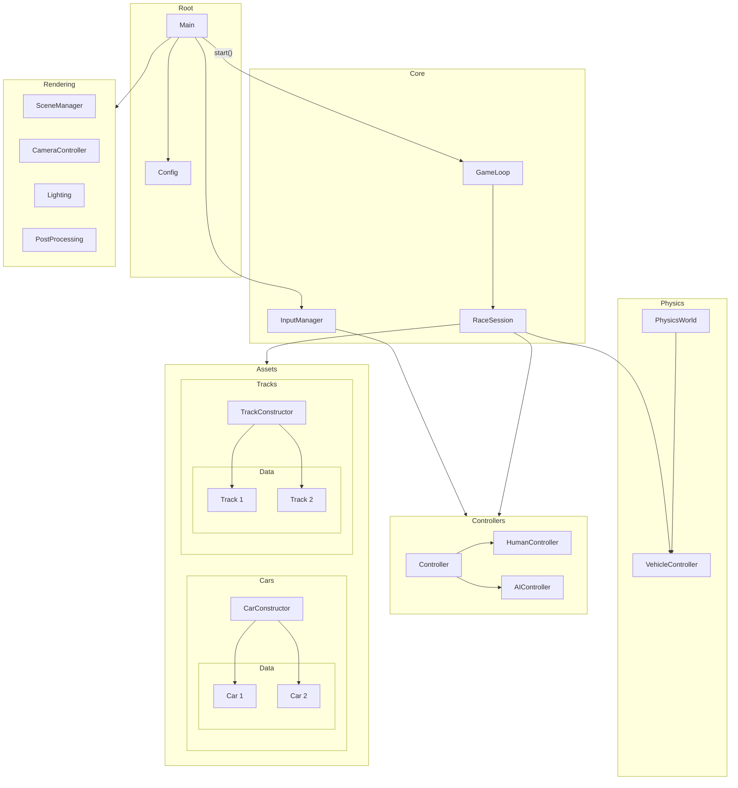
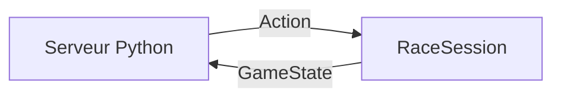

## Start project

cd ai  
uv sync  
cd ..  
cd game  
npm install  
npm run dev  

## Manually start the python server

cd ai 
uv run main.py

---

## Architecture

Jeu de course automobile 3D construit pour le web. Le point d'entrée `main.ts` orchestre les systèmes persistants ; chaque course est encapsulée dans une `RaceSession` jettable.

### Boucle principale

`App.start()` initialise le menu puis démarre la boucle avec `this.loop.start()`. La boucle elle-même est implémentée dans GameLoop.ts:23 : start() demande une première image au navigateur avec requestAnimationFrame(this.tick). À chaque image, tick() se redemande via requestAnimationFrame, avance la physique à pas fixe avec fixedUpdate, puis appelle render pour dessiner la scène.

La boucle `GameLoop` gère les images de toute l’application, des menus au jeu principal.

La course n’a pas sa propre boucle. `RaceSession` est créée quand l’application démarre une course, dans main.ts:203. Ensuite, `App.fixedUpdate()` vérifie qu’une session existe et lui transmet chaque pas physique avec `this.session.fixedUpdate(dt, racing)` (main.ts:274). C’est là que la session fait avancer la course.

Donc le chemin est : `GameLoop.tick()` → `App.fixedUpdate()` → `RaceSession.fixedUpdate()`. Dans les menus, il n’y a pas de `RaceSession` active, donc la course n’avance pas.

### Stack

| Couche      | Technologie                        |
| ----------- | ---------------------------------- |
| Build       | Vite + TypeScript                  |
| Rendu       | Three.js (WebGL)                   |
| Physique    | Rapier.js (WASM, véhicule raycast) |
| UI          | DOM + CSS                          |
| Persistance | `localStorage` (meilleurs temps)   |
| IA          | Serveur Python (WebSocket)         |

### Game architecture 

### Couplage des responsabilités

| Module              | Rôle                                                                                         |
| ------------------- | -------------------------------------------------------------------------------------------- |
| `main.ts`           | Machine à états UI, cycle de vie des sessions, câblage global                                |
| `RaceSession`       | Frontière simulation/rendu : construit le monde, avance la physique, expose l'état interpolé |
| `Controller`        | Découple l'entrée (humain / IA) de `VehicleController` via `ControlState`                    |
| `TrackConstructor`  | Visuel + colliders + courbe centrale + spawn + progression sur piste                         |
| `Race`              | Règles de course (tours, chrono, delta, records) indépendantes de la physique                |
| `VehicleController` | Seul module qui parle à Rapier pour le véhicule                                              |
| `VehicleView`       | Représentation Three.js synchronisée avec la physique                                        |

### Intégration IA 

Chaque frame, `RaceSession` peut pousser une observation (position, capteurs raycast, progression) vers `AIController`, qui relaie les actions reçues du serveur externe.

## Conduite 

### Acceleration

Quand tu maintiens **↑**, le jeu lit la touche comme un accélérateur numérique à pleine puissance : `throttle = 1`. Ce signal est transmis au contrôleur de la voiture, qui applique une force moteur aux roues motrices via le modèle de véhicule à roues simulées par raycast de Rapier.

La force diminue avec la vitesse. Le code calcule :

`F_moteur = 9200 × (1 − 0,6 × min(1, v / v_max))`

Pour la voiture configurée dans le jeu, `v_{max}=82 m/s`, soit environ **295 km/h**. La force vaut donc 9 200 à l’arrêt, puis baisse progressivement jusqu’à 40 % de cette valeur à la vitesse maximale. Elle est répartie entre les roues motrices, qui sont les deux roues arrière dans cette configuration. Au seuil maximal, le moteur cesse de pousser.

La vitesse obtenue ne vient pas d’une accélération fixée directement : elle résulte de cette force appliquée aux roues, de leur adhérence, de la masse de la voiture (1 000 kg) et de la dynamique du véhicule calculée par Rapier. Le châssis a aussi un amortissement linéaire, qui freine légèrement son mouvement.

En pratique, c’est donc un modèle de conduite simplifié : pas de régime moteur, de vitesses ou de courbe de couple détaillée. La courbe de force est définie dans VehicleController.ts:145, la touche ↑ dans InputManager.ts:36, et les paramètres du véhicule dans car_1.ts:10.

## Backlog : 

quand je vais vite et que je tourne, j'ai l'impression que ça réduit ma vitesse. 
réduire le dezoom quand on va vite
j'ai l'impression que les roues arrière glissent
mettre un eboule noire dans le cockpit de la voiture trackmania
- problème d'alignement des roues
- on ne peut pas assez tourner à haute vitesse
- Ajouter un ou deux points de visée (lookahead): direction vers un point sur la courbe centrale 10 /25m devant. Comme ça l'agent voit le virage. (a faire avant le système de checkpoints)
- Track : changements d'altitude, des virages inclinés, un saut/une rampe, et une boucle ou un boost pad si possible. **Contrôle de l'assiette en vol** réglage de l'assiette (tangage) et du roulis en plein vol, à la manière de Trackmania.
- **Plateformes de boost** et **surfaces modifiant la vitesse** (par exemple, zones à faible adhérence / de terre) en option.
- **4 roues** avec paramètres configurables : suspension travel, stiffness, damping, friction. Animation des roues : rotation de direction sur les roues avant + rotation de roulement sur toutes les roues en fonction de la vitesse.
- Faire un menu système solaire, l'utilisateur peut choisir la planète et, pour chaque planète, il y aura un stade d'entrainement pour tester la gravité, les mécaniques de jeu etc. et plusieurs circuits dans cet environnement. La dernière track du jeu sera un parcours multi planètes à la course arc en ciel Mariokart avec une fin dans le soleil ou trou noir. 
- Ghost car (meilleur temps) : Enregistrement de la position/rotation toutes les 100ms via un `GhostRecorder`, Stockage dans `localStorage` (format JSON compressé), Replay transparent (mesh semi-transparent) pendant la course suivante.
- Effets particules : Fumée de pneus au freinage/dérapage, Poussière au dépassement des bordures
- **Système de checkpoints :** A mettre dans src/track/Checkpoint.ts. Volumes de déclenchement invisibles ; doivent être franchis dans l'ordre ; chronométrage intermédiaire (écart en temps réel par rapport au record personnel (vert/rouge)). Permettra le respawn si reset (touche R) ou si voiture retournée.
- **Prise en charge de la manette** via l'API Gamepad (direction/accélérateur analogiques) — important pour les sensations. Rendre la couche d'entrée abstraite afin que le clavier et la manette fournissent les mêmes valeurs de contrôle.
- Minimap (facultatif, top-down orthographic render sur render target séparé)
- frein arrière différentiel pour le handbrake (touche Space)
- Appui aérodynamique/traînée aérodynamique affectant la maniabilité à grande vitesse.
- Audio/Musique/Effet sonores
- Prévoir un cycle jour/nuit 
- Détection de voiture retournée pendant > 2s
- Respawn au début du circuit avec vitesse nulle (animation de fondu)
- Multijoueur

